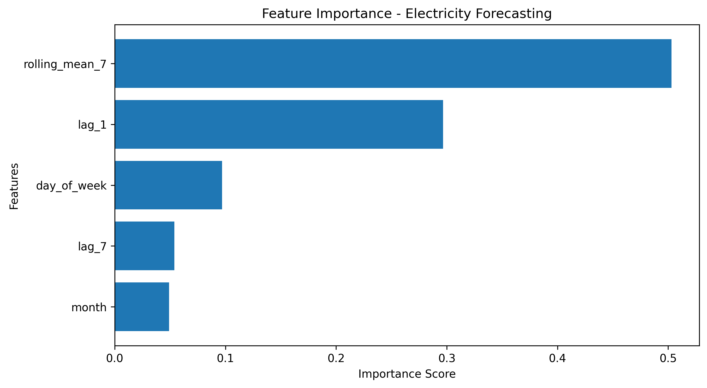

# Household Electricity Consumption Analysis & Forecasting

## Project Overview

This project focuses on analysing and forecasting household electricity consumption using historical electricity usage data.

The project uses the Individual Household Electric Power Consumption dataset to explore electricity consumption patterns, perform exploratory data analysis, prepare time-series data, and develop machine learning models to predict daily average electricity consumption.

## Project Objectives

- Analyse historical household electricity consumption.
- Identify consumption patterns and trends over time.
- Perform data cleaning and preprocessing.
- Visualise hourly and daily electricity consumption.
- Develop machine learning models for consumption forecasting.
- Evaluate model performance using appropriate metrics.
- Compare actual and predicted electricity consumption.

## Dataset

**Dataset:** Individual Household Electric Power Consumption

**Source:** UCI Machine Learning Repository

The dataset contains household electricity measurements collected over several years.

The analysis primarily uses the `Global_active_power` variable to study electricity consumption.

## Technologies Used

- Python
- Pandas
- NumPy
- Matplotlib
- Scikit-learn
- Google Colab
- GitHub

## Project Workflow

### 1. Data Collection
- Obtained the household electricity consumption dataset.
- Loaded the dataset into Google Colab.

### 2. Data Cleaning and Preprocessing
- Handled missing values.
- Converted date and time columns into datetime format.
- Processed the complete dataset in chunks.
- Aggregated hourly electricity consumption.
- Handled isolated missing hourly values while preserving longer missing periods.

### 3. Exploratory Data Analysis
- Analysed electricity consumption statistics.
- Visualised hourly consumption trends.
- Resampled hourly data into daily average consumption.
- Examined consumption patterns over time.

### 4. Feature Engineering
Created forecasting features including:
- Previous day's consumption (`lag_1`)
- Previous week's consumption (`lag_7`)
- Seven-day rolling average
- Day of the week
- Month

### 5. Model Development

The project uses machine learning approaches for daily electricity consumption forecasting:

- Baseline forecasting approach
- Random Forest Regressor
- Gradient Boosting Regressor

### 6. Model Evaluation

The Random Forest model was evaluated using:

| Metric | Result |
|---|---:|
| MAE | 0.1836 |
| RMSE | 0.2426 |
| R² Score | 0.4680 |

The dataset was divided chronologically:
- Training records: 1,091
- Testing records: 273

The evaluation metrics represent daily average electricity consumption prediction performance.

## Project Files

| File | Description |
|---|---|
| `household_electricity_forecasting.ipynb` | Complete analysis, preprocessing, visualisation and forecasting notebook |
| `model_performance_results.csv` | Model performance metrics |
| `electricity_forecasting_results.csv` | Actual and predicted electricity consumption values |
| `README.md` | Project documentation |

## Key Learning Outcomes

- Working with large datasets using Pandas.
- Handling missing values in time-series data.
- Performing time-based data aggregation.
- Creating lag and rolling-window features.
- Implementing machine learning regression models.
- Evaluating forecasting performance.
- Documenting and managing projects using GitHub.

## Future Improvements

- Experiment with additional forecasting algorithms.
- Improve model performance through hyperparameter tuning.
- Explore seasonal and trend-based forecasting.
- Perform more detailed feature importance analysis.
- Develop an interactive electricity consumption dashboard.

- ## Model Performance Comparison

Three approaches were evaluated using the same chronological training and testing split.

| Model | MAE | RMSE | R² Score |
|---|---:|---:|---:|
| Baseline | 0.2099 | 0.2900 | 0.2398 |
| Random Forest | 0.1836 | 0.2426 | 0.4680 |
| Gradient Boosting | 0.1692 | 0.2372 | 0.4913 |

### Best Performing Model

**Gradient Boosting Regressor** achieved the best performance among the three evaluated models.

- Lowest MAE: 0.1692
- Lowest RMSE: 0.2372
- Highest R² Score: 0.4913

### Model Comparison CSV

The complete model comparison results are available in `model_comparison_results.csv`.

## Feature Importance Analysis

Feature importance was analysed using the Gradient Boosting Regressor to understand which input variables contributed most to the model's predictions.

| Feature | Importance |
|---|---:|
| rolling_mean_7 | 0.502979 |
| lag_1 | 0.296744 |
| day_of_week | 0.097077 |
| lag_7 | 0.053979 |
| month | 0.049222 |

### Key Findings

- The 7-day rolling average was the most influential feature.
- Previous day's consumption was the second most influential feature.
- Day of the week also contributed to the predictions.

### Visualization

## Author

**Kavya Shree R Sekar**

- [LinkedIn](https://www.linkedin.com/in/kavya-shree-r-sekar-07a08833a/)
- [GitHub](https://github.com/Kavya-shree1506)
